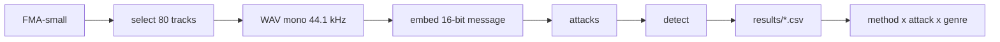

# Robust Music Watermarking: Extended Benchmark

A benchmark that checks whether audio watermarks survive realistic transformations of **music**, across genres. Semester project, course "Artificial Intelligence", Ukrainian Catholic University (2026). Built from [`ucu-ai-course/project-template`](https://github.com/ucu-ai-course/project-template).

## Team

| Name | GitHub | Role |
|---|---|---|
| Iryna Svyrydenko | [@irasvyrydenko](https://github.com/irasvyrydenko) | AudioSeal, compression attacks, review of RAW-Bench |
| Lili Alania | [@LiliAlania](https://github.com/LiliAlania) | WavMark, noise and filtering attacks, review of AudioMarkBench |
| Bohdana Zubrytska | [@bohda6na](https://github.com/bohda6na) | audiowmark, time and dynamics attacks, metrics and thresholds, review of classical methods |

Mentor: Olesia Omelchuk.

## Problem and motivation

Audio watermarking embeds an inaudible identifier into a signal. It is used to label AI-generated music and to protect creators' rights. Most existing methods were designed and evaluated on speech, and their robustness is usually measured in lab conditions rather than under transformations a real track meets (streaming compression, tempo changes, noise). Existing benchmarks (RAW-Bench, AudioMarkBench) cover this only partly, and none focuses on music across genres. This project builds a music-focused benchmark and compares several watermarking methods under identical attacks.

## Data

FMA-small: 8,000 tracks, 30 s each, 8 balanced genres. Source: https://github.com/mdeff/fma. Test subset: the first 10 tracks (by sorted `track_id`) of each genre, 80 tracks in total (`data/selected_80.csv`). Audio is not stored in this repository (size and per-track licences). Licences, preprocessing and download instructions: [`data/README.md`](data/README.md).

## Approach



All methods embed the same 16-bit message and are attacked with the same parameters.

| Method | Type | Status |
|---|---|---|
| audiowmark | classical, frequency-domain (patchwork) | done: 80 tracks, all attack groups incl. EnCodec (34 rows per track) |
| AudioSeal | neural | done: 80 tracks, all attack groups incl. EnCodec (34 rows per track) |
| WavMark | neural | done: 80 tracks, all attack groups incl. EnCodec (34 rows per track) |

| Attack group | Attacks and parameters | Code | Status |
|---|---|---|---|
| Time and dynamics | speed 0.9 / 0.95 / 1.05 / 1.1x, time stretch (same rates), pitch shift ±1 / ±2 semitones, gain ±6 dB, crop to 50% | `attacks/time_dynamics.py` | done |
| Compression | MP3 and AAC at 128 / 64 / 32 kbps, EnCodec (neural codec) at 24 / 12 / 6 / 3 / 1.5 kbps | `attacks/compression.py` | done |
| Noise and filtering | Gaussian noise (30 / 20 / 10 dB SNR), low-pass 3 kHz, high-pass 300 Hz, reverb (5 echoes, 50 ms, decay 0.4) | `attacks/noise_filtering.py` | done |

Metrics: robustness is the share of tracks where the watermark is still detected (bit accuracy at least 14/16). Audio quality is the SNR between the original and the watermarked track. Details: [`docs/metrics.md`](docs/metrics.md).

## Results

### audiowmark

audiowmark on 80 tracks (10 per genre), default embedding strength, 34 rows per track
(`results/results_audiowmark.csv`). Share of tracks where the 16-bit message is read (at least 14/16 bits):

| Attack | Parameters | Detection rate |
|---|---|---|
| none | - | 1.00 |
| MP3, AAC | 128 / 64 / 32 kbps | 1.00 |
| gain | -6 dB, +6 dB | 1.00 |
| crop | keep first 50% | 1.00 |
| Gaussian noise | SNR 30 / 20 / 10 dB | 1.00 / 0.98 / 0.80 |
| low-pass | 3 kHz | 1.00 |
| high-pass | 300 Hz | 1.00 |
| reverb | 5 echoes, 50 ms, decay 0.4 | 1.00 |
| EnCodec (neural codec) | 24 / 12 / 6 / 3 / 1.5 kbps | 0.00 / 0.00 / 0.00 / 0.00 / 0.00 |
| speed | 0.9x, 0.95x, 1.05x, 1.1x | 0.00 |
| time stretch | 0.9x, 0.95x, 1.05x, 1.1x | 0.00 |
| pitch shift | -2, -1, +1, +2 semitones | 0.00 |
| unwatermarked track (control) | - | 0.00 |

- Speed, time stretch, pitch shift and the EnCodec neural codec remove the watermark: detection is 0.00 even for mild changes (5% tempo, 1 semitone) and for EnCodec at 24 kbps, the highest bitrate we tested. Compression with MP3 and AAC, filtering, reverb, gain and crop do not affect it.
- Gaussian noise is the only attack where the result is not 0 or 1: 10 dB SNR loses the message in 16 of 80 tracks. In all 16 the decoder found no message at all. The two misses at 20 dB are the tracks with the highest embedding SNR (51.0 and 46.9 dB); this is an observation on 80 tracks, not a tested cause.
- With the `--detect-speed` option, speed changes of 0.9x and 1.1x are fully compensated (detection 1.00 in all 80 tracks, no bit errors) and on unwatermarked tracks it gives no false positives (0 of 80). It is tested separately and is not part of the main comparison, because AudioSeal and WavMark have no equivalent.
- No false positives: on the 80 unwatermarked tracks the decoder found no message.
- SNR after embedding: mean 31.0 dB (range 25.5 to 51.0). Genre means lie between 29.9 dB (Hip-Hop) and 33.9 dB (Electronic).

### AudioSeal

Results for AudioSeal on the same 80 tracks under all three attack groups: compression,
time/dynamics, noise/filtering (`results/results_audioseal.csv`, 34 rows per track). AudioSeal gives two outputs:

- **message read**: at least 14 of 16 bits correct, the shared team criterion (`detected` column);
- **watermark found**: AudioSeal's own detector, probability > 0.5 (`detect_prob` column).

| Attack | Parameters | Message read | Watermark found |
|---|---|---|---|
| none | - | 0.64 | 1.00 |
| MP3 | 128 / 64 / 32 kbps | 0.63 / 0.60 / 0.59 | 1.00 / 1.00 / 1.00 |
| AAC | 128 / 64 / 32 kbps | 0.61 / 0.65 / 0.50 | 1.00 / 1.00 / 1.00 |
| EnCodec | 24 / 12 kbps | 0.39 / 0.28 | 0.99 / 0.99 |
| EnCodec | 6 / 3 / 1.5 kbps | 0.01 / 0.00 / 0.00 | 0.30 / 0.16 / 0.03 |
| gain | -6 dB / +6 dB | 0.60 / 0.59 | 1.00 / 1.00 |
| crop | keep first 50% | 0.84 | 1.00 |
| speed | 0.9x, 0.95x, 1.05x, 1.1x | 0.00 | 0.00 |
| pitch shift | -2, -1, +1, +2 semitones | 0.00 | 0.00 |
| time stretch | 0.9x / 0.95x / 1.05x / 1.1x | 0.05 / 0.08 / 0.40 / 0.29 | 0.00 |
| Gaussian noise | SNR 30 / 20 / 10 dB | 0.43 / 0.33 / 0.18 | 1.00 / 1.00 / 0.96 |
| low-pass | 3 kHz | 0.64 | 1.00 |
| high-pass | 300 Hz | 0.70 | 1.00 |
| reverb | 5 echoes, 50 ms, decay 0.4 | 0.64 | 1.00 |
| unwatermarked track (control) | - | 0.00 | 0.00 |

Message read with no attack, by genre (10 tracks each):

| Electronic | Folk | Instrumental | Pop | Hip-Hop | International | Rock | Experimental |
|---|---|---|---|---|---|---|---|
| 0.9 | 0.8 | 0.7 | 0.7 | 0.6 | 0.6 | 0.5 | 0.3 |

- **The watermark itself survives MP3 and AAC at every bitrate, in every genre** (found in 100% of tracks). The EnCodec neural codec removes it at 6 kbps and below.
- **Speed and pitch shift remove the watermark completely**, even at 5% or one semitone, as for audiowmark. Gain and crop do not affect it (found in 100% of tracks).
- **Filters and reverb do not hurt AudioSeal**: low-pass 3 kHz, high-pass 300 Hz and reverb keep both outputs at the no-attack level.
- **Gaussian noise damages the message, not the detector**: the message is read in 43% of tracks at 30 dB SNR and 18% at 10 dB, while the watermark is still found in 96-100%.
- **Time stretch is partly survived by the message but not by the detector**: up to 40% of tracks give at least 14/16 bits (1.05x), while the detector finds the watermark in none of them. The two outputs disagree here, so this should not be read as robustness.
- **The 16-bit message is the weak point, and the loss happens at embedding, not under attack.** With no attack only 51 of 80 tracks give at least 14/16 bits; MP3, AAC and gain change the mean by at most 0.7 bit. AudioSeal was trained on speech, which is the gap this project is about. Crop to 50% reads the message more often than no attack (0.84 vs 0.64); we have not checked why.
- **Genre matters for the message, not for detection.** Mean correct bits with no attack range from 13.3 (Experimental, Rock) to 15.2 (Folk); the watermark is found in 100% of tracks in every genre.
- **No false positives**: on unwatermarked tracks the message criterion and the detector never fire (mean 7.7 of 16 bits correct, i.e. chance).
- SNR after embedding: mean 25.5 dB (range 19.7 to 39.3), lower than audiowmark (31.0 dB). Genre means lie between 24.3 dB (Hip-Hop) and 27.3 dB (International).
- The 14/16 rule is stricter for AudioSeal than its own detector, so a comparison with audiowmark on the `detected` column alone understates AudioSeal for "is this track watermarked?".


Limitations: 80 tracks, so genre-level conclusions are preliminary (one track is 10 percentage points within a genre); one fixed message and embedding strength; no listening tests (SNR does not measure perceived quality); the source files are already mp3 decoded to WAV.

### Comparison of the three methods

All three methods are run on the same 80 tracks and the same 34 conditions (no attack, the unwatermarked control, and 32 attack variants including EnCodec). Message read = at least 14 of 16 bits correct, the share of 80 tracks. AudioSeal also has its own detector ("watermark found"). Plots: [`plots/midterm/`](plots/midterm/), table with 95% intervals: [`results/summary/comparison.md`](results/summary/comparison.md).

| Attack | Parameters | audiowmark | WavMark | AudioSeal: message read | AudioSeal: watermark found |
|---|---|---|---|---|---|
| none | - | 1.00 | 0.95 | 0.64 | 1.00 |
| MP3 | 128 / 64 / 32 kbps | 1.00 / 1.00 / 1.00 | 0.95 / 0.91 / 0.44 | 0.63 / 0.60 / 0.59 | 1.00 / 1.00 / 1.00 |
| AAC | 128 / 64 / 32 kbps | 1.00 / 1.00 / 1.00 | 0.95 / 0.90 / 0.51 | 0.61 / 0.65 / 0.50 | 1.00 / 1.00 / 1.00 |
| EnCodec | 24 / 12 / 6 / 3 / 1.5 kbps | 0.00 for all | 0.00 for all | 0.39 / 0.28 / 0.01 / 0.00 / 0.00 | 0.99 / 0.99 / 0.30 / 0.16 / 0.03 |
| speed | 0.9x / 0.95x / 1.05x / 1.1x | 0.00 for all | 0.85 / 0.00 / 0.00 / 0.84 | 0.00 for all | 0.00 / 0.00 / 0.00 / 0.01 |
| time stretch | 0.9x / 0.95x / 1.05x / 1.1x | 0.00 for all | 0.91 / 0.95 / 0.91 / 0.90 | 0.05 / 0.08 / 0.40 / 0.29 | 0.00 for all |
| pitch shift | -2, -1, +1, +2 semitones | 0.00 for all | 0.00 for all | 0.00 for all | 0.00 for all |
| gain | -6 / +6 dB | 1.00 / 1.00 | 0.95 / 0.89 | 0.60 / 0.59 | 1.00 / 1.00 |
| crop | keep first 50% | 1.00 | 0.95 | 0.84 | 1.00 |
| Gaussian noise | SNR 30 / 20 / 10 dB | 1.00 / 0.98 / 0.80 | 0.94 / 0.78 / 0.01 | 0.43 / 0.33 / 0.18 | 1.00 / 1.00 / 0.96 |
| low-pass | 3 kHz | 1.00 | 0.85 | 0.64 | 1.00 |
| high-pass | 300 Hz | 1.00 | 0.95 | 0.70 | 1.00 |
| reverb | 5 echoes, 50 ms, decay 0.4 | 1.00 | 0.83 | 0.64 | 1.00 |
| unwatermarked track (control) | - | 0.00 | 0.00 | 0.00 | 0.00 |
| SNR after embedding, mean (dB) | - | 31.0 | 37.3 | 25.5 | 25.5 |

- **Pitch shift is the only attack that no method survives at any setting**, for both outputs (0.00 everywhere).
- **Only WavMark survives time stretch (0.90-0.95) and speed 0.9x / 1.1x (0.85 / 0.84).** The same WavMark gives 0.00 at speed 0.95x and 1.05x. We do not know why and did not investigate. audiowmark and AudioSeal read nothing under speed and time stretch (AudioSeal's message at time stretch is partly read, up to 0.40, but its detector never fires).
- **EnCodec removes the watermark of audiowmark and WavMark at every bitrate, even 24 kbps.** AudioSeal's message survives only at 24 and 12 kbps (0.39 / 0.28), but its detector still fires in 99% of tracks there and in 3-30% at 6 kbps and below. We did not test why neural codec resynthesis removes the classical and WavMark marks; this is an observation.
- **audiowmark** survives compression with MP3 and AAC, filters, reverb, gain, crop and noise down to 20 dB (0.98); at 10 dB it keeps 0.80. **WavMark** is more sensitive to strong compression (MP3 32 kbps 0.44, AAC 32 kbps 0.51) and to noise at 10 dB (0.01). **AudioSeal's detector** is robust to everything except time, pitch and strong EnCodec, but the 16-bit message is read in only 64% of tracks even without an attack.
- The methods are **not compared at equal audio quality**: each runs at its default strength and the embedding SNR differs (WavMark 37.3 dB, audiowmark 31.0 dB, AudioSeal 25.5 dB). A higher SNR means a weaker change to the signal, so "method A is more robust than B" cannot be concluded from this table alone.
- WavMark does not read the message even without an attack in 4 of 80 tracks, all Experimental (tracks 897, 995, 997, 998).
- AudioSeal's detector and the 14/16 message criterion answer different questions; compare the "message read" columns across methods and use the last column only for "is this track watermarked?".
- With 10 tracks per genre, genre differences are preliminary (one track is 10 percentage points).

## Status, difficulties and next steps

### Where we are (midterm)

- Benchmark pipeline: one attack list (`attacks.all_attacks()`), one run script for all methods (`scripts/run_benchmark.py`), one comparison script (`scripts/compare_methods.py`), shared CSV format.
- audiowmark, AudioSeal and WavMark are run on all 80 tracks under all 34 conditions (no attack, control, 32 attack variants including EnCodec).
- First findings: pitch shift breaks all three methods; EnCodec breaks audiowmark and WavMark at every bitrate; only WavMark survives time stretch; compression, filters, reverb, gain and crop are survived by audiowmark and by AudioSeal's detector; Gaussian noise and strong compression separate the methods.

### Plan until the final report


| Step | What is left |
|---|---|
| Robustness vs quality | The methods run at their default strength, so their embedding SNR differs (25.5 / 31.0 / 37.3 dB). To compare robustness at equal quality we need runs at several strengths per method. |
| Statistical analysis | Intervals are in `results/summary/comparison.md`. Still to do: a per-genre analysis that goes beyond 10 tracks per genre, and an analysis by attack type. |
| Understanding the results | Check why pitch shift breaks every method, why WavMark survives speed 0.9x / 1.1x but not 0.95x / 1.05x, and why EnCodec breaks audiowmark and WavMark at 24 kbps. |
| Demo | Interactive demo: Upload, Embed, Attack, Detect, Results. Not built yet. |
| Own approach (optional in the proposal) | Only if the results give a clear direction, for example for pitch shift, which no method survived. Not started. |
| Documentation | Reproducible instructions, automated tests for attacks and metrics, final report. |

### Difficulties and what did not work

- **Pitch shift breaks every method we tested** (0.00 at +-1 and +-2 semitones, both outputs). audiowmark and AudioSeal also lose the watermark under speed and time stretch; audiowmark's `--detect-speed` option fixes speed changes (1.00 in all 80 tracks at 0.9x and 1.1x), but it did not help for time stretch or pitch on the one track we tried. We have not found a setup where any method survives pitch shift.
- **EnCodec removes the watermark of audiowmark and WavMark at every bitrate**, even 24 kbps. Only AudioSeal's detector partly survives it. We did not find out why.
- **AudioSeal reads the 16-bit message in only 64% of tracks even with no attack**, while its own detector finds the watermark in 100%. It was trained on speech, which is the gap the project is about. We do not know why crop to 50% reads the message more often (0.84) than no attack, or why time stretch reads the message in up to 40% of tracks while the detector finds none. These were not investigated.
- **WavMark behaves unevenly under speed:** 0.85 at 0.9x, 0.00 at 0.95x, 0.00 at 1.05x, 0.84 at 1.1x. Not investigated.
- **Methods are not compared at equal audio quality.** Each runs at its default embedding strength, so "more robust" can partly mean "stronger change to the signal". Our SNR is not a measure of what a listener hears.
- **WavMark was slow and needed several runs.** The free Colab GPU quota ran out, so the runs were split between team members and run on CPU. The WavMark wrapper changed along the way (the watermark residual is now added to the original, so content above 8 kHz is kept); the CSV in the repository is from the final version, and the first partial WavMark numbers are not comparable with it.
- **Result formats drifted between team members.** The audiowmark labels and the WavMark "no message" value differed from the shared format (for example `0.9` instead of `0.9x`, and `bit_acc = 0.0` instead of an empty value), and each of us first had a separate run script. We fixed this with `scripts/fix_audiowmark_labels.py` and the shared `run_benchmark.py`, but the fixes came late.
- **Setup is fragile.** audiowmark must be built from source and is tested only on Linux (Colab), and the build is repeated in every new Colab session. The audiowmark EnCodec run took about 80 s per track on a Colab CPU; AudioSeal on CPU takes about 36 s per track.
- **The speed attack changed between runs.** The notebook runs used `librosa.resample`, the scripts use `resample_poly`. The speed rows were not rerun; the effect on the results is not measured.
- **Limited data and no listening tests.** 80 tracks (10 per genre, the first by `track_id`, not random), one message, one strength, source files already mp3, no listening tests. For audiowmark only Gaussian noise gives detection rates between 0 and 1, so a genre comparison is possible mainly there.

## Quick start

audiowmark must be installed separately (https://github.com/swesterfeld/audiowmark, GPL, used as an external program). The pipeline was tested on Linux (Google Colab).

```bash
git clone https://github.com/bohda6na/music-watermark-benchmark.git
cd music-watermark-benchmark
pip install -r requirements.txt          # AudioSeal: pip install -r requirements-audioseal.txt
```

1. Get the audio. Sections 1 to 3 of [`notebooks/01_audiowmark_baseline.ipynb`](notebooks/01_audiowmark_baseline.ipynb) download FMA-small and convert the 80 selected tracks to mono 44.1 kHz WAV.
2. Run the benchmark, one command per method. All methods share the same loop and the same attack list (`attacks.all_attacks()`); each run is resumable (skips rows already in the CSV) and writes `results/results_<method>.csv`:

```bash
python -m scripts.run_benchmark --method audiowmark --wav-dir <wav-folder>
python -m scripts.run_benchmark --method audioseal  --wav-dir <wav-folder> --neural   # + EnCodec attack
python -m scripts.run_benchmark --method wavmark    --wav-dir <wav-folder>
```

Add `--limit 2` for a quick test. The older `python -m scripts.run_audioseal` / `run_audiowmark` commands still work and do the same.

3. Compare the methods (needs only the CSV files, no audio). This reads every `results/results_*.csv` and writes `results/summary/comparison.md` (method x attack table with 95% intervals, false positives, SNR, genres) plus `by_attack.csv` and `by_genre.csv`:

```bash
python -m scripts.compare_methods
python scripts/summarize_results.py results/results_audiowmark.csv    # checks of one file; or: make reproduce
```

AudioSeal details: [`docs/audioseal.md`](docs/audioseal.md). It runs on an NVIDIA GPU automatically if the CUDA build of torch is installed (see `requirements-audioseal.txt`): about 6 s per track on an RTX 4060 Laptop, about 36 s on CPU.

## Repository structure

```
.
├── attacks/       # attacks (compression, time_dynamics, noise_filtering); all_attacks() in __init__.py
├── methods/       # watermarking method wrappers (audiowmark, AudioSeal, WavMark)
├── scripts/       # run_benchmark.py (all methods), compare_methods.py, summarize_results.py, common.py
├── notebooks/     # 01_audiowmark_baseline.ipynb: data preparation and pilot experiments
├── data/          # selected_80.csv and data card (audio is not committed)
├── results/       # CSV files with results and their description
├── docs/          # proposal, metrics, classical methods review, AudioSeal notes, poster, slides
└── config/        # configuration
```

Automated tests for attacks and metrics are not written yet.

## Reproducibility

- One fixed 16-bit message for all methods (`MESSAGE` in `scripts/common.py`), embedding strength left at the default.
- Detection criterion: bit accuracy at least 14/16 (see `docs/metrics.md`).
- Result files are CSV with the columns `method, attack, params, genre, track_id, detected, snr, bit_acc` (the scripts also write `detect_prob`). This format is shared by all team members.
- The track selection is deterministic (first 10 tracks per genre by `track_id`), so every team member uses the same 80 tracks.

## AI usage

| Tool | Used for | How the result was checked |
|---|---|---|
| Claude | Review of the repository state, finding leftovers from the project template, rewriting this README and fixing `requirements.txt`, `pyproject.toml`, `scripts/summarize_results.py` | Read the diff; ran `scripts/summarize_results.py` on `results/results_audiowmark.csv` and compared with the table above |
| Claude | Drafting the audiowmark notebook (`notebooks/01_audiowmark_baseline.ipynb`), the time and dynamics attack code, the compression runs for audiowmark and the resumable run scripts | Ran everything in Google Colab on all 80 tracks; checked each CSV (rows per track, duplicates, identical SNR per track, control rows); identity attacks (speed 1.0x, stretch 1.0x, pitch 0) must read the message; compared the numbers in the text with `scripts/summarize_results.py` output |
| Claude | Reading the shared pipeline (`scripts/run_benchmark.py`, `scripts/compare_methods.py`), checking teammates' CSV files for completeness and format, drafting README and `results/README.md` text | Numbers recomputed from the CSV files before pasting; teammates' files were checked against the shared column format and the expected number of rows per track |

## Contribution statement

| Member | Contribution | Responsible for |
|---|---|---|
| Iryna Svyrydenko | 33.3% | AudioSeal wrapper and runs, compression attacks, RAW-Bench review, shared helpers (`scripts/common.py`) |
| Lili Alania | 33.3% | WavMark, noise and filtering attacks, AudioMarkBench review |
| Bohdana Zubrytska | 33.3% | audiowmark, time and dynamics attacks, metrics and thresholds, classical methods review, data card, repository structure, this README |

All members agree with this distribution. 

## License and citation

| | License | Notes |
|---|---|---|
| Code (this repo) | MIT, see [`LICENSE`](LICENSE) | Free to reuse |
| Data | FMA metadata CC BY 4.0; audio under licences chosen by each artist | Not MIT. Non-commercial research use, no redistribution. See [`data/README.md`](data/README.md) |
| audiowmark | GPL | Run as an external program, its code is not included |
| Text / poster / slides | CC BY 4.0 (recommended) | |

Dataset: M. Defferrard et al., "FMA: A Dataset For Music Analysis", ISMIR 2017.

## Acknowledgments

Built from [`ucu-ai-course/project-template`](https://github.com/ucu-ai-course/project-template). Thanks to the course instructors and our mentor.
