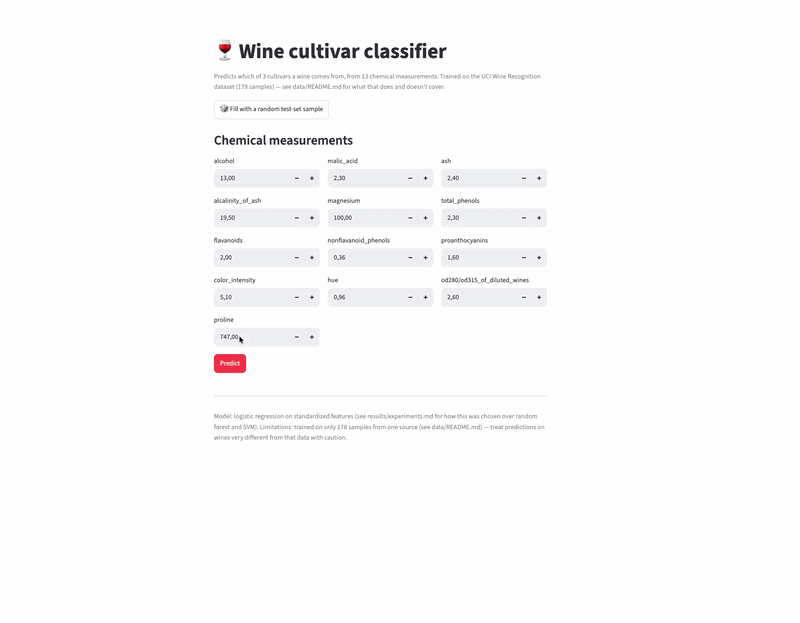
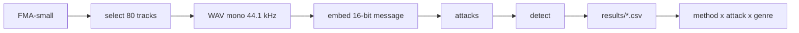

# Robust Music Watermarking: Extended Benchmark

A benchmark that checks whether audio watermarks survive realistic transformations of **music**, across genres. Built from [`ucu-ai-course/project-template`](https://github.com/ucu-ai-course/project-template). Semester project, course "Artificial Intelligence", Ukrainian Catholic University (2026).


> [!note]
> This repo is **both** a GitHub Template (click "Use this template" to get a clean, working starting point for your own semester project) **and** a fully filled-in example (this exact repo trains a real model and produces real numbers — nothing here is a placeholder). See §"Repository structure" for what to replace with your own project's content.

## Demo

`streamlit run app/streamlit_app.py` (see [`app/README.md`](app/README.md)) launches the demo below: enter 13 chemical measurements (or click "fill with a random test-set sample"), get a predicted cultivar and class probabilities.



## Team

| Name | GitHub | Role |
|---|---|---|
| Iryna Svyrydenko | [@irasvyrydenko](https://github.com/irasvyrydenko) | AudioSeal, compression attacks, review of RAW-Bench |
| Lili Alania | [@lilialania](https://github.com/LiliAlania) | WavMark, noise and filtering attacks, review of AudioMarkBench |
| Bohdana Zubrytska | [@bohda6na](https://github.com/bohda6na) | audiowmark, time and dynamics attacks, metrics |

### Mentor: Olesia Omelchuk

## Problem and motivation

Audio watermarking embeds an inaudible identifier into a signal. It is used to label AI-generated music and to protect creators' rights. Most existing methods were designed and evaluated on speech, and their robustness is usually measured in lab conditions rather than under transformations a real track meets (streaming compression, tempo changes, noise). Existing benchmarks (RAW-Bench, AudioMarkBench) cover this only partly, and none focuses on music across genres. This project builds a music-focused benchmark and compares several watermarking methods under identical attacks.

## Data

FMA-small: 8,000 tracks, 30 s each, 8 balanced genres. Source: https://github.com/mdeff/fma. Test subset: the first 10 tracks (by sorted `track_id`) of each genre, 80 tracks in total (`data/selected_80.csv`). Audio is not stored in this repository. Licences and download instructions: [`data/README.md`](data/README.md).

> [!note] Why this matters: data isn't part of this git repo
> `data/`, like `models/`, is gitignored. Committing raw data bloats the repo forever (`git rm` doesn't remove history — see `data/README.md`), makes diffs unreadable, and often runs into licenses that don't actually permit redistribution. Instead, `data/raw/CHECKSUMS.txt` **is** committed — a few bytes that let anyone verify they regenerated the exact same data, without the data itself ever touching git.

## Approach



Methods, all embedding the same 16-bit message:
- audiowmark (classical, spread spectrum)
- AudioSeal (neural) [status: ...]
- WavMark (neural) [status: ...]

Attacks, with the same parameters for every method:
- Time and dynamics (implemented in `src/[...]/attacks.py`): speed change, time stretch, pitch shift, gain, crop
- Compression, noise and filtering: implemented by teammates [status: ...]

Metrics: robustness is the share of tracks where the watermark is still detected (bit accuracy at least 14/16). Audio quality is the SNR between the original and the watermarked track. Details: [`docs/metrics.md`](docs/metrics.md).

## Results

Preliminary results for audiowmark on 80 tracks (10 per genre):
- No attack, gain of -6 dB and +6 dB, crop to 50%: watermark detected in all 80 tracks.
- Speed change, time stretch and pitch shift: not detected in any track, even for mild changes (5% and 1 semitone).
- With the `--detect-speed` option, speed changes of 0.9x and 1.1x are fully compensated (detection 100%, bit accuracy 1.0). This option was tested separately and is not part of the main comparison, because the other methods have no equivalent.
- SNR after embedding: mean 31.0 dB (range 25.5 to 51.0). The mean per genre lies between 29.9 dB (Hip-Hop) and 33.8 dB (Electronic).

Limitations: pilot sample of 80 tracks, one method so far, one fixed message and embedding strength, no listening tests (SNR does not measure perceived quality), and genre-level conclusions are preliminary. Raw results: `results/`. Experiments notebook: `notebooks/`.


| Model | Test accuracy | Test macro-F1 | CV accuracy (mean ± std) |
|---|---|---|---|
| Baseline (most-frequent class) | 0.389 | 0.187 | 0.399 ± 0.015 |
| **Logistic regression (selected)** | 0.972 | 0.971 | **0.983 ± 0.014** |
| Random forest (200 trees) | 1.000 | 1.000 | 0.978 ± 0.021 |
| SVM, default hyperparameters — *rejected* | 0.694 | 0.558 | 0.674 ± 0.040 |


> [!note] Why this matters: a metric without a baseline row means nothing
> "97% accuracy" sounds great until you notice the majority class alone is ~40% of the test set — at which point 97% is either impressive or barely-better-than-guessing, and you can't tell which without the baseline row above. Report it every time, not just when it's flattering.

> [!note] Why this matters: one seed isn't a conclusion
> Look at the table above: random forest scores *higher* on the single test split (1.000 vs 0.972) than logistic regression — but logistic regression wins on 5-fold CV, both on the mean **and** with a lower std. With only 36 test samples, one flipped prediction moves accuracy by ~2.8 points — enough to flip a ranking that a single split would have gotten wrong. That's why we selected the model on CV numbers, not the test-set numbers. Full writeup: [`results/experiments.md`](results/experiments.md).

## Quick start

```bash
git clone https://github.com/bohda6na/music-watermark-benchmark.git
cd music-watermark-benchmark
pip install -e .
```

audiowmark must be installed separately (https://github.com/swesterfeld/audiowmark). The pipeline was tested on Linux (Google Colab). WAV files are mono, 44.1 kHz, converted from the FMA mp3 files with ffmpeg.

```bash
python scripts/select_tracks.py
python scripts/run_benchmark.py --wav-dir <path-to-wav-folder> --out results/results_audiowmark.csv
```

> [!important]
> `make setup` uses `python3.13` by default (`PYTHON=python3.13` in the `Makefile`) — if that's not on your `PATH`, either install it or run `make setup PYTHON=python3.11` (3.11+ works fine, this project has no 3.13-only dependency).
>
> `setup` and `reproduce` are the only two `Makefile` targets — deliberately, as a small example of the pattern rather than a wrapper around everything. Every other command in this README (training, the demo, linting, tests) is run directly; see "Development" below.

### Tooling is this template's default, not a course requirement

This repo uses `pip` + `flake8` + `black` + `isort` because that's the lowest common denominator most students already know. Nothing about the course methodology requires exactly this — a `uv` + `ruff` setup (faster, less config) is a perfectly fine substitute, and what's graded is that your environment is reproducible and your code is consistently formatted, not which tool you used to get there. If you switch, it's about this much code:

```bash
uv venv && uv pip install -r requirements.txt -r requirements-dev.txt
ruff check . && ruff format --check .
```

## Repository structure

## Repository structure

```
.
├── src/[...]/      # attacks, metrics, method wrappers
├── scripts/         # track selection, benchmark runs
├── notebooks/       # experiments with explanations
├── data/            # selected_80.csv, data card (audio is not committed)
├── results/         # CSV files with results
├── docs/            # proposal, metrics, poster, slides
└── tests/           # tests for attacks and metrics
```

Everything above (except the placeholders in `docs/proposal|poster|slides/`) is real, executed, working content — clone it and run it, don't take our word for it.

## Reproducibility

- Fixed message `a5c3` (16 bits), embedding strength left at the default (10).
- Detection threshold: bit accuracy at least 14/16.
- Result files are CSV with the columns `method, attack, params, genre, track_id, detected, snr, bit_acc`. This format is shared by all team members.


> [!note] Why this matters: a seed alone isn't reproducibility
> Fixing the seed makes a run *repeatable* on your own machine. It's `env_info()` — capturing exact library versions, OS, and the git commit — that makes it *reproducible* somewhere else, months later, when a library's default behavior has quietly changed underneath an unpinned dependency.

## Development

```bash
flake8 src/ scripts/ tests/ app/ && black --check src/ scripts/ tests/ app/ && isort --check src/ scripts/ tests/ app/  # what CI runs
black src/ scripts/ tests/ app/ && isort src/ scripts/ tests/ app/                                                     # auto-fix formatting
pytest                                                                                                                  # full suite runs in under a second
```

Pre-commit hooks (installed by `make setup`) catch most of this before you even open a PR — see `.pre-commit-config.yaml`.

> [!note] Why this matters: CI enforces it instead of "we agreed to"
> "The team agreed to run black before committing" survives about one deadline-week skip before someone's code silently stops matching. A red `lint` check in CI is unambiguous, and — importantly — **a red CI check blocks merging**: reviewing a PR you can't tell has passed its own tests is a bad use of a reviewer's time, so don't merge over red CI, fix it first.

## AI usage

| Tool | Used for | How the result was checked |
|---|---|---|
| GitHub Copilot | Autocomplete while writing `src/wine_origin/evaluate.py` | Read line by line; covered by `tests/test_reproducibility.py` and `tests/test_models.py` |
| ChatGPT | Explaining the difference between macro- and micro-averaged F1 before choosing which to report | Cross-checked against the scikit-learn docs for `f1_score` |
| Claude | First draft of this README's prose | Rewritten by hand; every number was replaced with the actual value from `results/metrics.json`, not left as generated |

**What we didn't delegate:** the model-selection decision itself (§Results) — specifically, noticing that the single-split ranking disagreed with the cross-validated ranking, and choosing to trust CV — was made by reading the actual numbers, not accepted from a tool's suggestion. Any hyperparameter or architecture choice that ended up in `config/default.yaml` was verified by rerunning `python scripts/run_experiment.py` ourselves, not taken on faith.

## Contribution statement

| Member | Contribution | Responsible for |
|---|---|---|
| Iryna Svyrydenko | 33,33% | `src/wine_origin/` (data, models, evaluate), `scripts/run_experiment.py`, notebooks 01–03, tests |
| Lili Alania | 33,33% | `cli.py`, `app/streamlit_app.py`, CI workflow, `docs/`, notebook 04 |
| Bohdana Zubrytska | 33,33% | audiowmark as the third method, time and dynamics attacks, metrics and thresholds, runs on the 80-track subset, repository structure, this README |

Both members agree with the above distribution.

## License and citation

| | License | Notes |
|---|---|---|
| Code (this repo) | MIT — see [`LICENSE`](LICENSE) | Free to reuse, including commercially |
| Data | See [`data/README.md`](data/README.md) | **Not MIT** — the dataset's own terms apply, independent of this repo's code license |
| Trained model | Inherits the data's terms + this repo's code license | See [`models/README.md`](models/README.md) |
| Text / poster / slides | CC BY 4.0 (recommended) | Attribute this repo if reused |

> [!important] Why this matters: MIT on the repo does not cover the data
> The single most common licensing mistake in student projects: assuming an MIT `LICENSE` file at the repo root means *everything* in the repo — including any data you collected or redistributed — is under that license. It doesn't. Code and data are licensed independently; check both.

Citing this project: see [`CITATION.cff`](CITATION.cff) (GitHub renders a "Cite this repository" button from it automatically). Citing the underlying dataset: see [`data/README.md`](data/README.md).

## Acknowledgments

Built from [`ucu-ai-course/project-template`](https://github.com/ucu-ai-course/project-template). Thanks to the course instructors and our project mentor for feedback throughout the semester.
