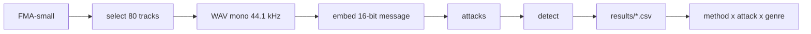

# Robust Music Watermarking: Extended Benchmark

A benchmark that checks whether audio watermarks survive realistic transformations of **music**, across genres. Semester project, course "Artificial Intelligence", Ukrainian Catholic University (2026). Built from [`ucu-ai-course/project-template`](https://github.com/ucu-ai-course/project-template).

## Team

| Name | GitHub | Role |
|---|---|---|
| Iryna Svyrydenko | [@irasvyrydenko](https://github.com/irasvyrydenko) | AudioSeal, compression attacks, review of RAW-Bench |
| Lili Alania | [@LiliAlania](https://github.com/LiliAlania) | WavMark, noise and filtering attacks, review of AudioMarkBench |
| Bohdana Zubrytska | [@bohda6na](https://github.com/bohda6na) | audiowmark, time and dynamics attacks, metrics and thresholds, review of classical methods |

Mentor: Olesia Omelchuk.

## Problem and motivation

Audio watermarking embeds an inaudible identifier into a signal. It is used to label AI-generated music and to protect creators' rights. Most existing methods were designed and evaluated on speech, and their robustness is usually measured in lab conditions rather than under transformations a real track meets (streaming compression, tempo changes, noise). Existing benchmarks (RAW-Bench, AudioMarkBench) cover this only partly, and none focuses on music across genres. This project builds a music-focused benchmark and compares several watermarking methods under identical attacks.

## Data

FMA-small: 8,000 tracks, 30 s each, 8 balanced genres. Source: https://github.com/mdeff/fma. Test subset: the first 10 tracks (by sorted `track_id`) of each genre, 80 tracks in total (`data/selected_80.csv`). Audio is not stored in this repository (size and per-track licences). Licences, preprocessing and download instructions: [`data/README.md`](data/README.md).

## Approach



All methods embed the same 16-bit message and are attacked with the same parameters.

| Method | Type | Status |
|---|---|---|
| audiowmark | classical, frequency-domain (patchwork) | done: 80 tracks, time and dynamics attacks |
| AudioSeal | neural | wrapper, smoke test and run script in the repo; full results pending |
| WavMark | neural | in progress |

| Attack group | Attacks and parameters | Code | Status |
|---|---|---|---|
| Time and dynamics | speed 0.9 / 0.95 / 1.05 / 1.1x, time stretch (same rates), pitch shift ±1 / ±2 semitones, gain ±6 dB, crop to 50% | `attacks/time_dynamics.py` | done |
| Compression | MP3 and AAC at 128 / 64 / 32 kbps, optional EnCodec | `attacks/compression.py` | implemented |
| Noise and filtering | Gaussian noise (30 / 20 / 10 dB SNR), low-pass / high-pass, reverb | not in the repo yet | in progress |

Metrics: robustness is the share of tracks where the watermark is still detected (bit accuracy at least 14/16). Audio quality is the SNR between the original and the watermarked track. Details: [`docs/metrics.md`](docs/metrics.md).

## Results

Preliminary results for audiowmark on 80 tracks (10 per genre), default embedding strength:

| Attack | Parameters | Detection rate |
|---|---|---|
| none | - | 1.0 |
| gain | -6 dB, +6 dB | 1.0 |
| crop | keep first 50% | 1.0 |
| speed | 0.9x, 0.95x, 1.05x, 1.1x | 0.0 |
| time stretch | 0.9x, 0.95x, 1.05x, 1.1x | 0.0 |
| pitch shift | -2, -1, +1, +2 semitones | 0.0 |

- Speed, time stretch and pitch shift break the watermark even for mild changes (5% tempo, 1 semitone).
- With the `--detect-speed` option, speed changes of 0.9x and 1.1x are fully compensated (detection 1.0). It is tested separately and is not part of the main comparison, because AudioSeal and WavMark have no equivalent.
- SNR after embedding: mean 31.0 dB (range 25.5 to 51.0). Genre means lie between 29.9 dB (Hip-Hop) and 33.8 dB (Electronic).

Limitations: 80 tracks, so genre-level conclusions are preliminary (for every attack so far the detection rate is 0 or 1 in all genres); one fixed message and embedding strength; no listening tests (SNR does not measure perceived quality); the source files are already mp3 decoded to WAV. AudioSeal and WavMark results will be added after the CSV files are merged. Details and raw files: [`results/`](results/README.md).

## Quick start

audiowmark must be installed separately (https://github.com/swesterfeld/audiowmark, GPL, used as an external program). The pipeline was tested on Linux (Google Colab).

```bash
git clone https://github.com/bohda6na/music-watermark-benchmark.git
cd music-watermark-benchmark
pip install -r requirements.txt          # AudioSeal: pip install -r requirements-audioseal.txt
```

1. Get the audio. Sections 1 to 3 of [`notebooks/01_audiowmark_baseline.ipynb`](notebooks/01_audiowmark_baseline.ipynb) download FMA-small and convert the 80 selected tracks to mono 44.1 kHz WAV.
2. Run the benchmark for audiowmark (resumable, skips rows already in the CSV):

```bash
python -m scripts.run_audiowmark --wav-dir <wav-folder> --out results/results_audiowmark.csv
```

3. Print the main numbers from a results file (needs only the CSV, no audio):

```bash
python scripts/summarize_results.py results/results_audiowmark.csv    # or: make reproduce
```

AudioSeal: `python -m scripts.run_audioseal --wav-dir <wav-folder> --out results/results_audioseal.csv` (see [`docs/audioseal.md`](docs/audioseal.md)).

## Repository structure

```
.
├── attacks/       # attack implementations (compression.py, time_dynamics.py)
├── methods/       # watermarking method wrappers (audiowmark, AudioSeal)
├── scripts/       # run_*.py (benchmark runs), summarize_results.py, common.py (shared helpers)
├── notebooks/     # 01_audiowmark_baseline.ipynb: data preparation and pilot experiments
├── data/          # selected_80.csv and data card (audio is not committed)
├── results/       # CSV files with results and their description
├── docs/          # proposal, metrics, classical methods review, AudioSeal notes, poster, slides
└── config/        # configuration
```

Automated tests for attacks and metrics are not written yet.

## Reproducibility

- One fixed 16-bit message for all methods (`MESSAGE` in `scripts/common.py`), embedding strength left at the default.
- Detection criterion: bit accuracy at least 14/16 (see `docs/metrics.md`).
- Result files are CSV with the columns `method, attack, params, genre, track_id, detected, snr, bit_acc` (the scripts also write `detect_prob`). This format is shared by all team members.
- The track selection is deterministic (first 10 tracks per genre by `track_id`), so every team member uses the same 80 tracks.

## AI usage

| Tool | Used for | How the result was checked |
|---|---|---|
| Claude | Review of the repository state, finding leftovers from the project template, rewriting this README and fixing `requirements.txt`, `pyproject.toml`, `scripts/summarize_results.py` | Read the diff; ran `scripts/summarize_results.py` on `results/results_audiowmark.csv` and compared with the table above |

<!-- TODO(Bohdana): add every other tool you used (code, notebook, text) and how you checked it. Teammates add their own rows. -->

## Contribution statement

| Member | Contribution | Responsible for |
|---|---|---|
| Iryna Svyrydenko | 33.3% | AudioSeal wrapper and runs, compression attacks, RAW-Bench review, shared helpers (`scripts/common.py`) |
| Lili Alania | 33.3% | WavMark, noise and filtering attacks, AudioMarkBench review |
| Bohdana Zubrytska | 33.3% | audiowmark, time and dynamics attacks, metrics and thresholds, classical methods review, data card, repository structure, this README |

All members agree with this distribution. <!-- TODO: confirm with Iryna and Lili before the midterm. -->

## License and citation

| | License | Notes |
|---|---|---|
| Code (this repo) | MIT, see [`LICENSE`](LICENSE) | Free to reuse |
| Data | FMA metadata CC BY 4.0; audio under licences chosen by each artist | Not MIT. Non-commercial research use, no redistribution. See [`data/README.md`](data/README.md) |
| audiowmark | GPL | Run as an external program, its code is not included |
| Text / poster / slides | CC BY 4.0 (recommended) | |

Dataset: M. Defferrard et al., "FMA: A Dataset For Music Analysis", ISMIR 2017.

## Acknowledgments

Built from [`ucu-ai-course/project-template`](https://github.com/ucu-ai-course/project-template). Thanks to the course instructors and our mentor.